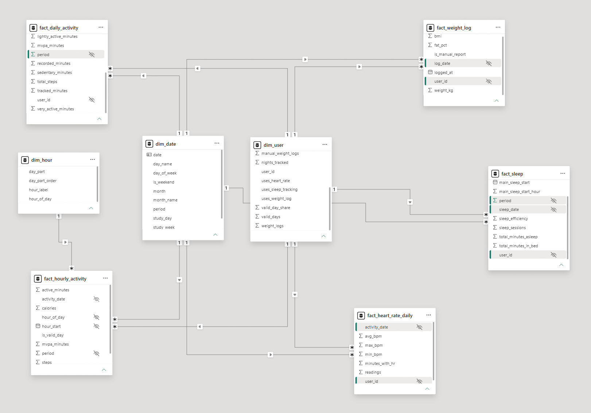
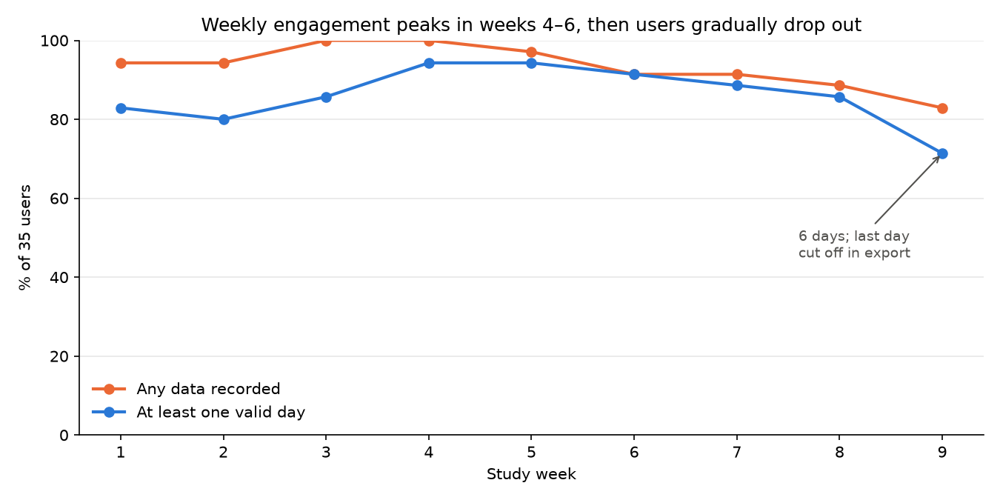
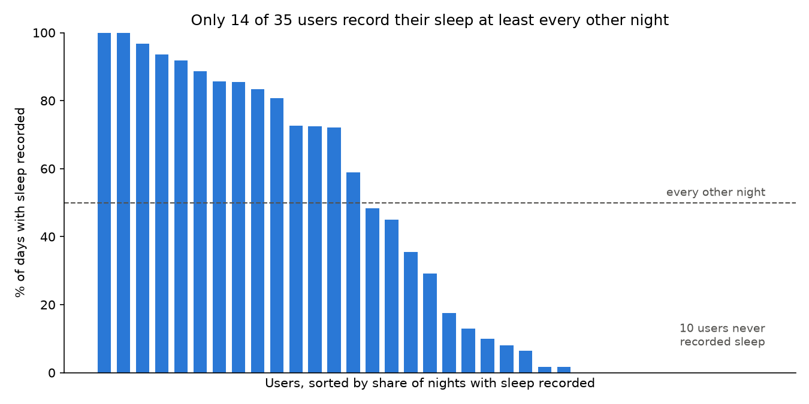
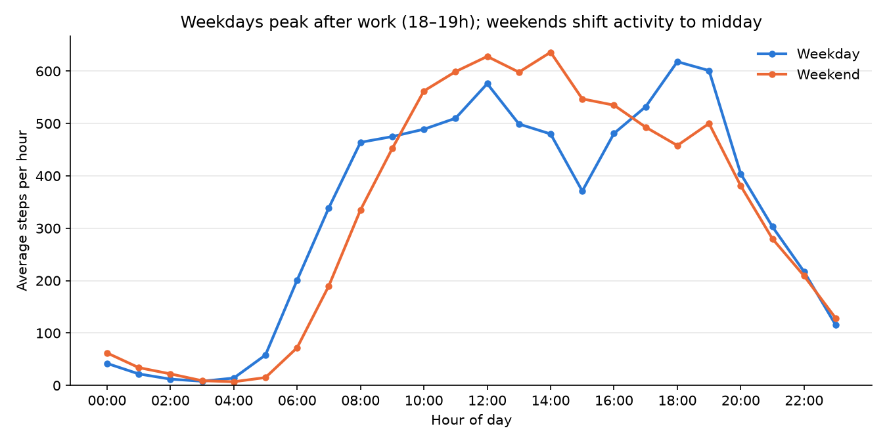
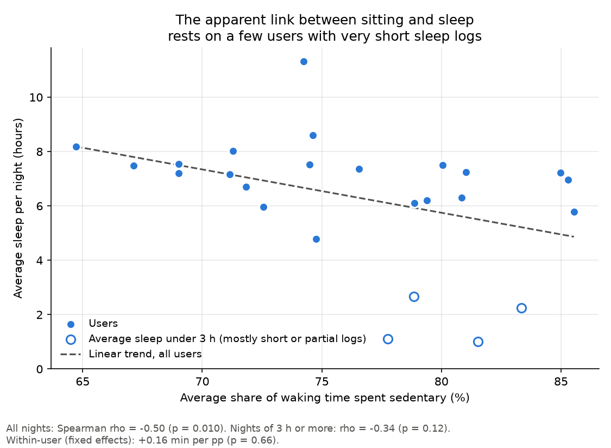
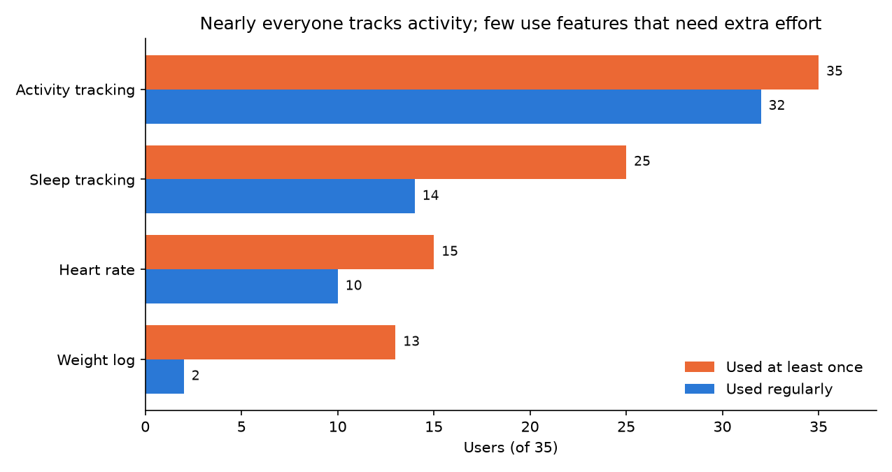
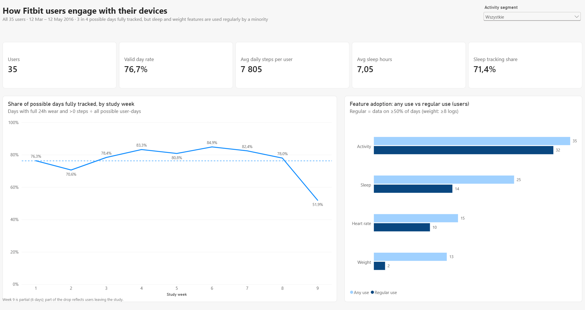
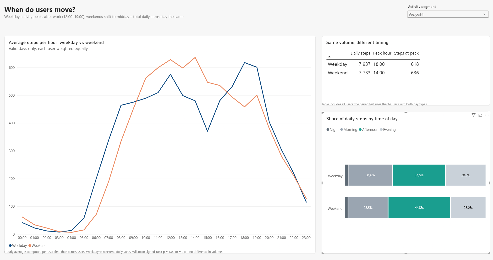
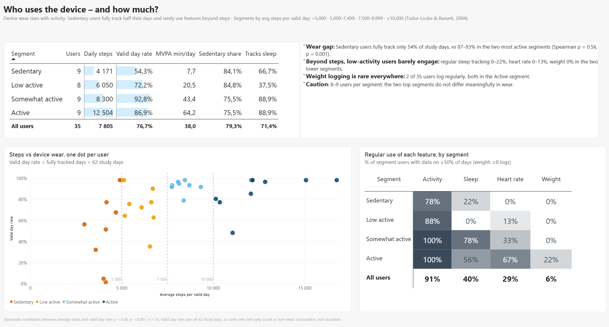
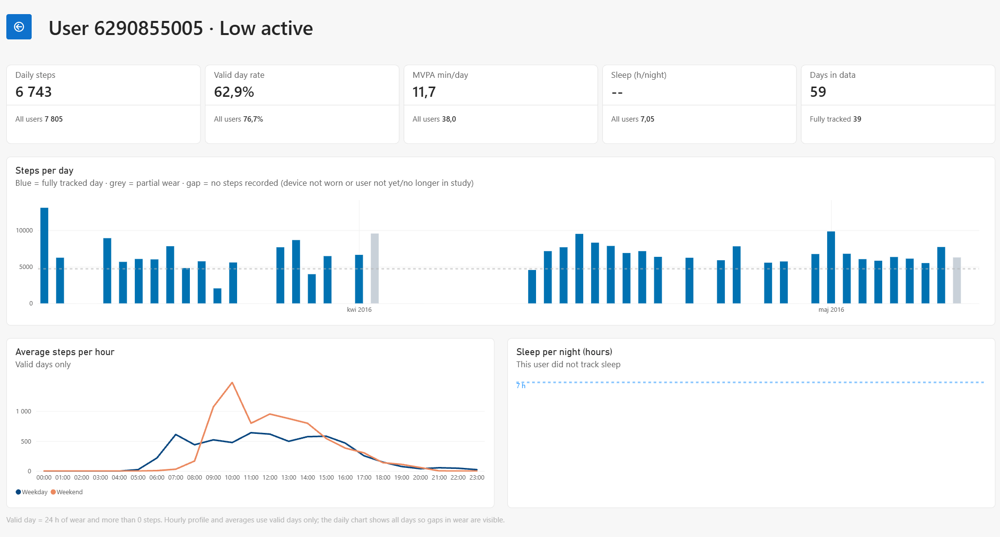

# Bellabeat Case Study: How Fitbit Users Engage with Their Devices

**Business question:** How do people actually use their fitness trackers, and what should Bellabeat change in its onboarding, notifications and product features as a result?

**Tools:** BigQuery (SQL) · Python (pandas, SciPy, statsmodels) · Power BI (DAX) · Git

**Report:** [PDF export](dashboard/bellabeat_report.pdf) · [Power BI file](dashboard/bellabeat_dashboard.pbix) · [Analysis notebook](notebooks/analysis.ipynb)

---

## Executive summary

**Wear is the first bottleneck, and it is concentrated among the least active users.** Across 35 users and 62 days, only 76.7% of possible user-days were fully tracked. The least active segment wore the device on 54% of days, compared with 87–93% in the two most active segments (Spearman ρ = 0.56, p = 0.001). Features beyond step counting are used regularly by a minority: sleep by 14 of 35 users, heart rate by 10, weight by 2.

| # | Finding | Evidence |
|---|---|---|
| 1 | Engagement dips early and fades at the end, but users who stay keep a stable routine | Valid day rate 76.3% in week 1, **70.6% in week 2**, peak 84.9% in week 6; no difference between the two data periods per user (Wilcoxon p = 0.69); 4 of 35 users stop sending data before the last full week |
| 2 | Less active users wear the device less | Valid day rate: Sedentary **54%**, Low active 72%, Somewhat active 93%, Active 87% |
| 3 | Beyond steps, adoption is thin and uneven | Regular use: activity 32/35, sleep 14/35, heart rate 10/35, weight 2/35; two users account for 76.5% of all weight entries |
| 4 | Users move the same amount on weekdays and weekends, but at different times | Weekday peaks at **18:00–19:00**, weekend at **11:00–14:00**; afternoon share of steps 37.5% → 44.3%; daily volume unchanged (Wilcoxon p = 1.00, n = 34) |
| 5 | A sedentary day does not predict a shorter next night | No robust within-user effect once sub-3-hour sleep logs are excluded (p = 0.10); weekend nights are **22.5 min longer** (p = 0.008) |

## Recommendations

| Recommendation | Why | KPI | Test |
|---|---|---|---|
| **1. A 14-day onboarding programme focused on wearing the device** (wear streaks, charging reminders, a day-7 check-in) | Week 2 is the weakest week; wear gaps, not low activity, are what the data loses first | Valid day rate in days 1–14; share of users still active in week 4 | A/B: guided onboarding vs current experience, new users only |
| **2. Time activity nudges to the user's own rhythm** | Weekday activity peaks after work, weekends around midday | Notification open rate; steps in the 2 hours after a nudge | A/B: nudges at the user's personal peak hour vs a fixed time |
| **3. Design for the least active users, not the most active** (lower starting goals, comfort and style messaging for wearing all day) | The bottom segment wears the device half as often, so it is both the hardest to reach and the one with most to gain | Valid day rate and median steps in the bottom two segments | A/B: personalised starting goal vs a fixed 10,000-step goal |
| **4. Make sleep and weight tracking passive** (automatic sleep detection by default, smart-scale sync instead of manual entry) | Manual logging is rare: 64% of weight entries are manual and almost all come from two users | Share of users with sleep data on ≥50% of nights; users with ≥8 weight entries | Measure before/after rollout; compare with a holdout group |

These are hypotheses to test, not proven effects: the data come from 35 Fitbit users in 2016, not from Bellabeat customers.

---

## Data

- **Source:** [Fitbit Fitness Tracker Data](https://www.kaggle.com/datasets/arashnic/fitbit) (Kaggle, CC0). Survey via Amazon Mechanical Turk, 12 March – 12 May 2016, exported from Fitabase in two periods.
- **Scope:** 15 raw tables (daily, hourly and minute activity, minute sleep, heart rate per second, weight log). The dataset description mentions 30 users; the files contain **35 distinct IDs**, all kept.
- **Unit of analysis:** the **valid day**, 24 hours of recorded wear and more than 0 steps. 1,664 of 1,966 user-days qualify. Heart-rate data confirm the rule: on valid days with heart-rate data, the median wear time is 16.6 hours, while zero-step days average 0.2 hours.

## Approach

```
Raw CSVs ──► BigQuery
               fitbit_raw    15 tables, loaded with explicit schemas
               fitbit_clean  audited, deduplicated, rebuilt and validated tables
               fitbit_mart   star schema: 3 dimensions + 5 fact views
                    │
                    ├──► Python    hypothesis tests (H1–H5), figures
                    └──► Power BI  interactive report (import mode)
```

The analysis followed the usual ask → prepare → process → analyze → share → act cycle, but the report is written answer-first: each hypothesis was stated before the analysis and is reported with its result and the test behind it.

**Data preparation highlights** (full log: [`docs/data_quality_log.md`](docs/data_quality_log.md))

- The period 1 daily file covers only 2 users until 24 March. Daily totals were **rebuilt from minute and hourly data** and validated on period 2, where both versions exist: steps within 1% on 94.0% of days, calories on 94.5%, sedentary minutes within 5 minutes on 96.8%. Official rows take priority; rebuilt rows only fill gaps (`data_source` column).
- Sleep sessions were deduplicated and assigned to the **wake-up date**; this rule reproduces the official `sleepDay` file exactly on all 410 comparable nights.
- Weight logs are keyed on user + log ID, because log IDs repeat across users.
- Every mart table is covered by tests: row counts, orphan keys (0) and segment assignment.

Data model: [`docs/data_model.md`](docs/data_model.md)



## Results by hypothesis

### H1. Engagement fades over time
**Partly supported.** Engagement dips in week 2 and drops in the final, partial week as users leave, but users who stay show no decline between the two data periods (mean per-user valid day share 76.4% vs 77.0%, Wilcoxon p = 0.69).



### H2. Users who track sleep are more engaged overall
**Not supported at conventional significance.** Sleep trackers walk more (median 8,136 vs 6,314 steps per valid day) and wear the device more often (median 93.5% vs 71.2% of their days in the study), but with 25 vs 10 users the differences are not significant (Mann–Whitney p = 0.10 and p = 0.11). The gap is large enough to be worth re-testing on a bigger sample.



### H3. Activity timing differs between weekdays and weekends
**Supported for timing, not for volume.** Weekday activity peaks after work (18:00: 618 steps/hour), weekend activity around midday (14:00: 636). Daily volume does not differ (7,937 vs 7,839 steps, Wilcoxon p = 1.00, n = 34).



### H4. More sedentary days lead to shorter sleep
**Not supported.** The same-day correlation (r = −0.69) is mechanical: sleep and sedentary minutes share the same 24 hours. For the next night, the between-user correlation (ρ = −0.50) disappears once logs shorter than 3 hours are excluded (ρ = −0.34, p = 0.12), and the within-user fixed-effects estimate is not significant. The only robust effect is the weekend: +22.5 minutes of sleep (p = 0.008).



### H5. Manual-entry features are rarely used
**Supported.** 13 users logged weight at least once, but only 2 did so regularly; those two users account for 76.5% of all entries. Regular use falls from activity (32 users) to sleep (14), heart rate (10) and weight (2).



## Power BI report

Five pages built on the BigQuery mart, with DAX measures verified against the Python results on a hidden QA page.

| Page | Purpose |
|---|---|
| **Overview** | KPIs, weekly trend with a metric switch (field parameter), feature adoption |
| **Daily rhythm** | Hourly profile weekday vs weekend, peak hours, share of steps by time of day |
| **Segments** | Comparison of activity segments, steps vs wear per user, feature-use heatmap |
| **User profile** | Drill-through from any user: daily wear strip, hourly profile, sleep per night |
| **Tooltip** | Per-user summary on hover |

Techniques: star schema with single-direction relationships, measure table, iterators with context transition (`AVERAGEX`, `SUMX`), `REMOVEFILTERS` for share-of-total and reference values, `ADDCOLUMNS`/`TOPN` for peak hour, disconnected table with `SWITCH`, measure-driven conditional formatting, dynamic titles, synced slicers, bookmarks, drill-through and report-page tooltips.






## Limitations

- **Small, self-selected sample:** 35 users recruited via Mechanical Turk, 8–9 users per activity segment.
- **Not Bellabeat's audience:** no information on gender or age, although Bellabeat designs for women; the data come from Fitbit devices.
- **Old and short:** two months of data from 2016.
- **Wear cannot be measured directly:** the valid-day rule is a proxy, supported by heart-rate wear time for 15 users.
- **Observational data:** all relationships are associations, not causal effects; the recommendations above are designed to be tested.

## Reproduce

1. **BigQuery:** create a project (the free sandbox is enough) with datasets `fitbit_raw`, `fitbit_clean`, `fitbit_mart` in location EU. Load the CSVs as described in [`sql/00_load_raw.md`](sql/00_load_raw.md) using the schemas in `sql/schemas/`, then run `sql/01_*.sql` to `sql/07_*.sql` in order.
2. **Python:** `pip install -r requirements.txt`, authenticate with `gcloud auth application-default login`, set `PROJECT_ID` in the first cell and run `notebooks/analysis.ipynb`.
3. **Power BI:** open `dashboard/bellabeat_dashboard.pbix` and point the Google BigQuery connection to your project (Transform data → Data source settings).

The raw data are not stored in the repository; download them from Kaggle.

## Repository structure

```
bellabeat_case_study/
├── sql/
│   ├── 00_load_raw.md          loading instructions
│   ├── schemas/                JSON schemas for the raw tables
│   ├── 01_data_audit.sql
│   ├── 02_rebuild_daily.sql
│   ├── 03_clean_daily_activity.sql
│   ├── 04_clean_hourly_activity.sql
│   ├── 05_clean_sleep.sql
│   ├── 06_clean_weight_hr_users.sql
│   └── 07_mart_star_schema.sql
├── notebooks/
│   └── analysis.ipynb          hypothesis tests H1–H5
├── dashboard/
│   ├── bellabeat_dashboard.pbix
│   └── bellabeat_report.pdf
├── docs/
│   ├── data_quality_log.md     every cleaning decision and its check
│   ├── data_model.md           star schema and table grain
│   └── figures/
├── requirements.txt
└── README.md
```
