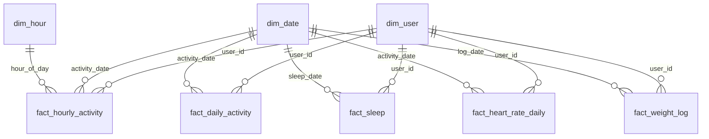

# Data model (fitbit_mart)

| Table | Grain | Rows |
|---|---|---|
| fact_daily_activity | user × day | 1,966 |
| fact_hourly_activity | user × hour | 46,008 |
| fact_sleep | user × night (wake-up date) | 832 |
| fact_heart_rate_daily | user × day | 469 |
| fact_weight_log | one weight entry | 98 |
| dim_user | user | 35 |
| dim_date | calendar day (12 Mar – 12 May 2016) | 62 |
| dim_hour | hour of day | 24 |

Activity segments in `dim_user` follow step-count categories by
Tudor-Locke & Bassett (2004), computed on valid days only.